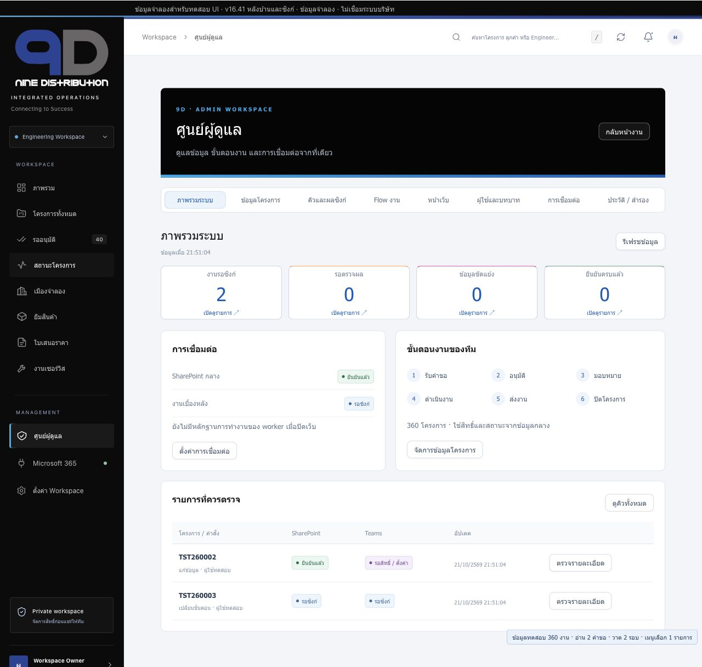
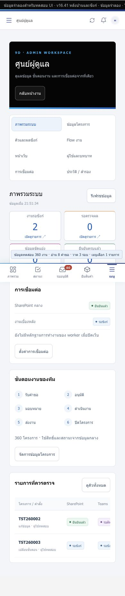
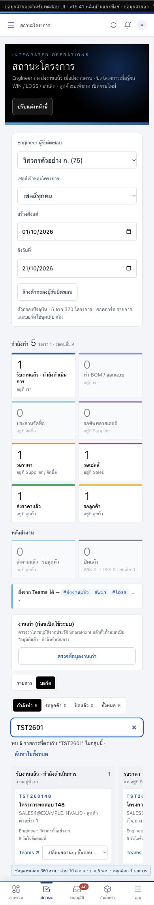
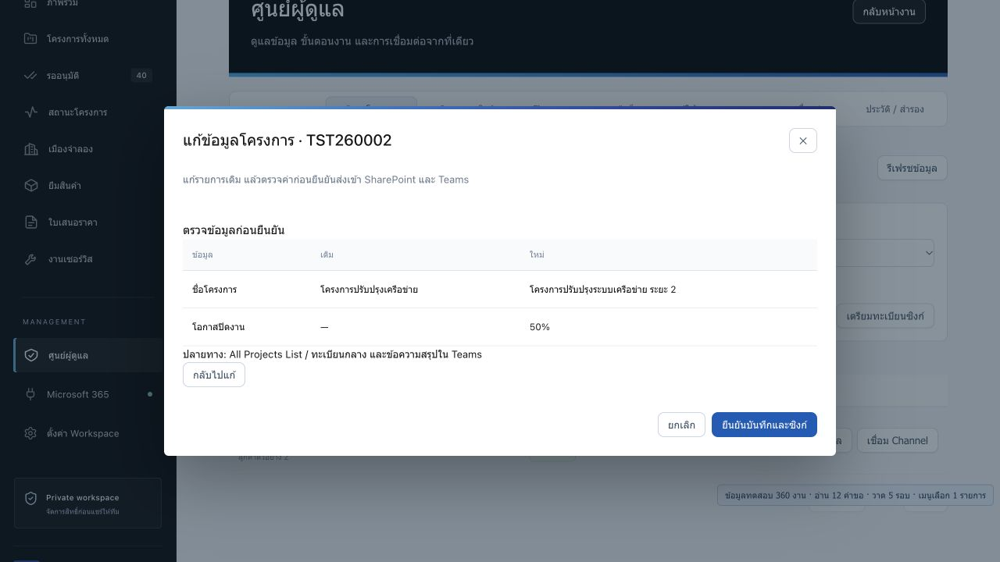
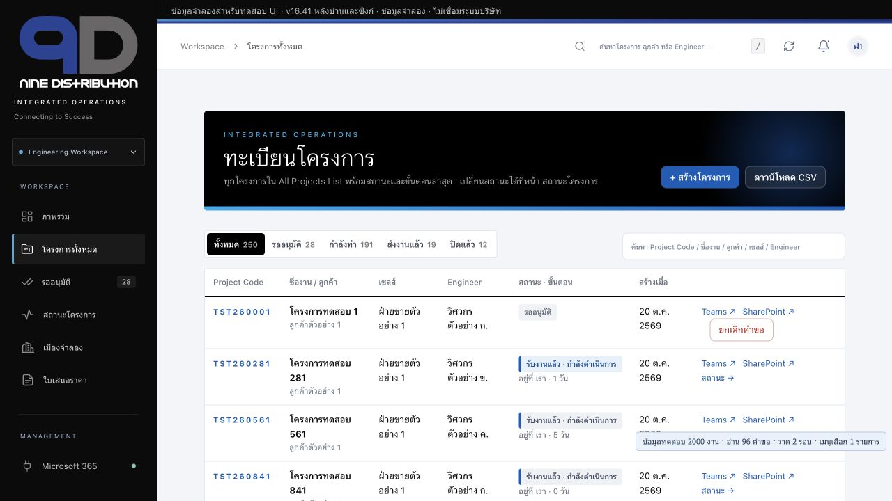

# v16.41 · หลักฐานทดสอบ

ทุกข้อมูลเป็นข้อมูลจำลอง ใช้ `example.invalid` / mock user ids เท่านั้น ไม่ login / อ่านข้อมูลจริง / แก้ ACL / สร้าง List ใน tenant บริษัท ไม่ merge/deploy ระหว่างพัฒนา

## อัตโนมัติ

```sh
node --test tests/*.test.cjs
```

**182 tests ผ่าน / 0 failed / 0 skipped** บน Node 24.19.0 (เครื่องพัฒนา). เพิ่มจากชุดเดิม 127 tests เป็นชุด Core/adapter/worker/หลังบ้านและเงื่อนไข UI รวม 182 tests

| ขอบเขต | หลักฐาน |
|---|---|
| Admin/Engineer/Sales/Viewer, own item, การถูกลดบทบาท | `sync-m365.test.cjs`, `admin-console.test.cjs`, `workspace-access-archive.test.cjs` |
| web→SP→Teams, Main/Directory→Teams, canonical Teams root/reply→SP | `sync-m365.test.cjs` เรียก adapter และ Core ตัวจริงผ่าน mock HTTP fixture |
| eTag/revision, กดซ้ำ/สอง worker/ข้อมูลขัดแย้ง | `sync-core.test.cjs` และ adapter tests |
| timeout ก่อน/หลัง POST, PATCH สำเร็จแต่ response หาย, receipt บันทึกไม่ครบ | Core tests: หา marker/GET ก่อนทำต่อ และไม่ POST ซ้ำเมื่อไม่ทราบผล |
| ปิด/เปิด client ใหม่และไม่มี browser | `sync-worker.test.cjs`: Sales ส่งคิว → Node runOnce → Teams command → Main/Directory โดยไม่มี DOM |
| ไม่เชื่อ receipt/actor ที่ผู้ใช้ใส่เอง | adapter tests ตรวจ Graph createdBy/lastModifiedBy/from.user.id; receipt ปลอมไม่ข้าม data write/read-back |
| read permission ก่อน project body ของผู้อื่น | adapter tests ตรวจว่า request ที่ถูกปฏิเสธไม่ fetch fields/Tracking ของผู้อื่น |
| เริ่มทะเบียนจาก Main / binding เดิมผิดรหัส | adapter tests ปฏิเสธ binding จน Admin ตรวจยืนยัน; คง owner จาก Microsoft |
| กติกาเตือน/ไม่เกิด loop/ปิดคำสั่ง/notify off | adapter tests เก็บ observed/published snapshot; เตือนครั้งเดียวต่อวันและแสดง N/A เหตุผลตรงกัน |
| HTTP 429/backoff/แยก token audience/ไม่ retry POST | `sync-worker.test.cjs` ใช้ mock fetch และ tokens ไม่ติดต่อ Microsoft |
| ฟอร์ม Flow ยืนยัน/ยกเลิก/ค่าผิด/ร่างเก่าทับค่าใหม่ | `backoffice-flow.test.cjs` เรียก handler จริงใน VM โดย mock confirm/settings store |
| ACL scope alignment ไม่ตัดผู้ดูแลก่อนเพิ่ม Full Control | `backoffice-flow.test.cjs` ตรวจคำสั่ง REST จำลองและลำดับ grant |
| 2,000 รายการ/ค้นหาท้ายชุด/คง focus/ตัวกรอง/board counts | `ui-stability.test.cjs` รวมกรองวันที่และยอด tab/card ตาม query โดยไม่สร้าง input ใหม่ |
| Quotation own-author, Archive read-back, PNG, menu/publish schema | ชุดเดิมที่ยังผ่านทั้งชุด |

ตรวจ `node --check` กับ inline script ก้อนใหญ่ที่สุดใน index.html, sync-core.js, sync-m365.js, worker.cjs, sw.js และ mock fixture/server พร้อม `git diff --check`.

ติดตั้ง dependency จาก worker lockfile แล้วตรวจโหลด `PublicClientApplication`, `PersistenceCreator.createPersistence`, `PersistenceCachePlugin`, `DataProtectionScope.CurrentUser` ได้จริง รวม native keytar; ไม่เรียก authentication หรือสร้าง token cache

## ตรวจในเบราว์เซอร์ด้วย mock

```sh
node tests/serve-workspace.cjs
# http://127.0.0.1:8771/?n=360&role=admin
# http://127.0.0.1:8771/?n=2000&role=sales
```

server กำหนด CSP connect-src self และใช้ sync-fixture.js แทน transport Microsoft. ไม่ใช้ความสำเร็จของ toast แทน receipt ในการตรวจ

- หลังบ้านแบ่ง 8 แผง; ตรวจภาพรวม/ข้อมูลโครงการ/คิว/Flow กับ 360 โครงการ แสดงคิว pending และ partial โดยแยก SP/Teams; กดประมวลผลแล้วอ่านยืนยันทั้งสองปลายทางในตาราง
- ค้น TST260002 → แก้ชื่อ → preview ค่าเดิม/ใหม่ → ยืนยัน → เห็นชื่อใหม่ในทะเบียนและ receipt ยืนยัน SP/Teams คำค้นเดิมยังอยู่
- มือถือ **390×844**: document width 390 ไม่มีแนวนอนล้นทั้งหน้า; ปุ่มหลังบ้านที่แสดงมีความสูงอย่างน้อย 44px; ช่องกรอกที่แสดงใช้ 16px ขึ้นไป
- มือถือ Status: Engineer + วันที่ 1–21 ต.ค. + `TST2601` เหลือ **5 โครงการ**; การ์ด active=5, tab active/all=5, delivered/closed=0, board รวม=5; focus ยังอยู่ในช่องค้นหา
- Sales ชุด **2,000 โครงการ** เห็นทะเบียน **250 รายการของตน** ไม่มีทางเข้า Admin; ไม่มี console error ที่อ่านจาก browser ในช่วงตรวจ
- ตรวจหน้า Flow/backup controls ใน DOM ได้; การกด native confirm ในรอบ browser เพิ่มเติมติดข้อจำกัดเครื่องมือควบคุม จึงไม่อ้างว่า browser ยืนยันการเผยแพร่ Flow สำเร็จ แยกตรวจ handler ยืนยัน/ยกเลิก/validation/conflict ด้วย VM mock ข้างต้น

## ภาพหน้าจอ

ภาพทั้งหมดเป็น mock จาก localhost ข้อความชื่อ/อีเมลเป็นข้อมูลสมมติ

### หลังบ้าน: คิวสำเร็จบางส่วนและ pending



### มือถือ: หลังบ้าน



### ผู้ใช้: filter/cards/tabs/board ชุดเดียวกัน



### ฟอร์มตรวจค่าเดิม/ใหม่ก่อนเขียน



### Sales กับข้อมูล 2,000 โครงการ



## สิ่งที่ยังไม่ยืนยันกับ Microsoft จริง

tenant consent/Conditional Access, ACL ของไซต์และ Main List, การเป็นสมาชิก Private Channel, SharePoint unique-field/role setup ตามนโยบาย tenant, Microsoft throttling/latency และ OS credential store ในเครื่อง worker เป้าหมาย. ผู้ดูแลต้องทดสอบใน tenant ทดสอบหลังอนุมัติ ตาม [ขั้นตอนตั้งค่า](ADMIN-SYNC.md) ไม่มีการสรุปว่าพร้อมใช้ production โดยไม่ผ่านขั้นตอนนี้
